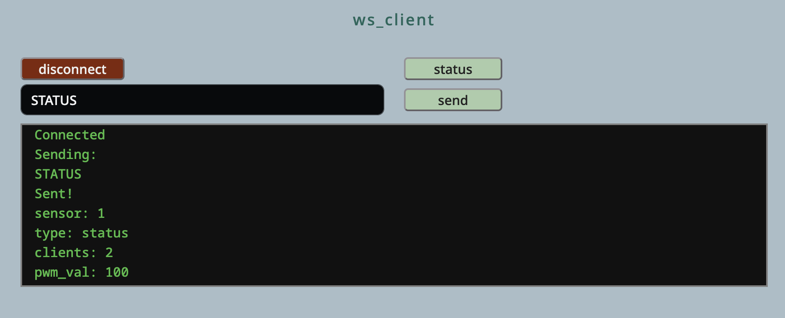

# PICO_WS_MP

This is MicroPython code to create a WebSockets server on a Raspberry Pi Pico 2W.

This was created mainly as a way of playing around with WebSockets.

The WebSockets code supports multiple clients because ... why not? Output to the clients consists of broadcasting the same messages to all those currently connected.

There are, in fact, two ways of communicating with the Pico. There's WebSockets (duh) and a CLI via the Pico's USB. Responses from the Pico get sent to both channels.

## WEBCLIENT

I've included a simple web client to show how you might communicate with the Pico. It's basic but (as far as I know) functional and should provide a good starting point.

This repo was set up to support an article on [_Machina Speculatrix_](https://medium.com/machina-speculatrix) (Medium subscription required).
